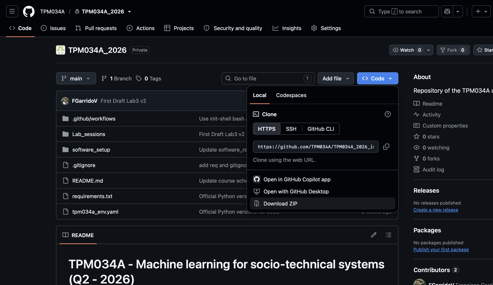
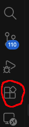
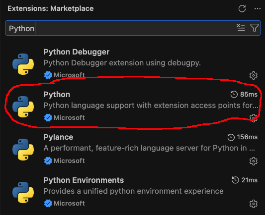

[← Back to Main Course README](../README.md)

---

# TPM034A - Software Requirements & Workspace Setup Guide

Welcome to the setup guide for **TPM034A - Machine Learning for Socio-Technical Systems (Q2 - 2026)**.

Lab sessions in this course require programming in Python using Jupyter Notebooks. To participate smoothly, you will need to prepare your machine by setting up a Python environment and an interactive code editor.

---

## Table of Contents
- [1. Overview](#1-overview)
- [2. SETUP 1: Anaconda (Recommended)](#2-setup-1-anaconda-recommended)
  - [2.1 Installing Anaconda](#21-installing-anaconda)
  - [2.2 Option A (Fastest & Recommended): Import from YAML / ZIP](#22-option-a-fastest--recommended-import-from-yaml--zip)
  - [2.3 Option B (Alternative): Empty Environment + `requirements.txt`](#23-option-b-alternative-empty-environment--requirementstxt)
  - [2.4 Setting up Visual Studio Code](#24-setting-up-visual-studio-code)
  - [2.5 Working in VS Code with your Environment](#25-working-in-vs-code-with-your-environment)
- [3. SETUP 2: Google Colab (Online Alternative)](#3-setup-2-google-colab-online-alternative)
- [4. Frequently Asked Questions & Troubleshooting](#4-frequently-asked-questions--troubleshooting)

---

## 1. Overview

You will need:
1. **A Python Interpreter and Package Manager:** We strongly recommend **Anaconda**. It manages isolated virtual environments and installs precompiled scientific packages seamlessly across Windows, macOS, and Linux.
2. **A Code Editor:** We recommend **Visual Studio Code (VS Code)** with the official Microsoft Python and Jupyter extensions.
3. *(Alternative)* **Google Colab:** If you cannot install software locally, you may use Google Colab in your browser.

> 📋 **Note for Beginners:**  
> If you are new to Python, we highly recommend completing **Lab Session 00** right after completing this setup. It introduces basic data structures, Pandas, data exploration, and visualization.

---

## 2. SETUP 1: Anaconda (Recommended)

### 2.1 Installing Anaconda
Download and install the official Anaconda distribution for your operating system:
* [Windows Installer](https://repo.anaconda.com/archive/Anaconda3-2026.07-1-Windows-x86_64.exe)
* [Mac (Apple Silicon / M-series)](https://repo.anaconda.com/archive/Anaconda3-2026.07-1-MacOSX-arm64.pkg)
* [Linux Installer](https://repo.anaconda.com/archive/Anaconda3-2026.07-1-Linux-x86_64.sh)

Run the installer and follow the on-screen instructions using the default settings.

---

### Choose ONE of the following options to create your Python environment:

---

### 2.2 Option A (Fastest & Recommended): Import from YAML / ZIP

This option automatically creates the environment and installs all official course packages pre-configured from `tpm034a_env.yaml` (aligned with the TU Delft 2026 freeze).

Before setting up your Anaconda, **copy or download** the course repository. To do so, 
- click the blue *Code button* in the top-right corner of the [course repo page](https://github.com/TPM034a/TPM034a_2026). 
- In the dropdown, select Download ZIP.
- Unzip the dowloaded folder.


#### Using Anaconda Navigator (Graphical Interface):
1. Locate the environment file:
   - Use the file `tpm034a_env.zip` located inside the folder you just unzipped.
2. Open **Anaconda Navigator**.
3. Click on **Environments** in the left sidebar.
4. Click the **Import** button at the bottom of the environments list.
5. In the pop-up window:
   - Keep or set the name to: `tpm034a`.
   - Click the folder icon next to **Specification File** and select `tpm034a_env.zip`.
6. Click **Import**. (Depending on your internet connection, this may take a few minutes).

---

### 2.3 Option B (Alternative): Empty Environment + `requirements.txt`

If you prefer to create a clean environment and install dependencies via `pip`, use the official [`requirements.txt`](../requirements.txt) file.

#### Using Anaconda Navigator (Graphical Interface):
1. Open **Anaconda Navigator** and go to **Environments** in the left sidebar.
2. Click **Create** at the bottom.
3. In the dialog:
   - **Name:** `tpm034a`
   - **Packages:** Check **Python** and select version **3.13**.
4. Click **Create** and wait for the base environment to be initialized.
5. In the environments list, click the green play icon (▶) next to `tpm034a` and select **Open Terminal**.
6. In the terminal window that opens, navigate to the folder containing `requirements.txt` and run:
   ```bash
   pip install -r requirements.txt
   ```

---

### 2.4. Install Visual Studio Code and its extensions

1. Go to the [Visual Studio Code download page](https://code.visualstudio.com/Download) and download the installer for your operating system.

2. Run the downloaded installer and follow the installation steps. When it is finished, open **Visual Studio Code**.

3. On the far-left edge of the VS Code window, find the vertical icon bar called the **Activity Bar**. Click the **Extensions** icon: it looks like four small squares, with one square separated from the other three.

   

4. The Extensions panel opens on the left. Click the search field at the top, type `Python`, and press Enter. In the results list, find **Python** with **Microsoft** shown underneath its name. Click that result, then click the blue **Install** button. Wait until the button changes to **Uninstall**; this confirms that it has been installed.

   

   Optionally, several other Python extensions, such as **Pylance**, can also be installed to enhance the development experience.

5. Click the Extensions search field again, type `Jupyter`, and press Enter. In the results list, find **Jupyter** with **Microsoft** shown underneath its name. Click that result, then click the blue **Install** button. Wait until the button changes to **Uninstall**.

---

### 2.5 Working in VS Code with your Environment

> ⚠️ **IMPORTANT STEP:**  
> Always open the **root folder of the course repository** in VS Code (the folder that contains `Lab_sessions/`, `requirements.txt`, and `tpm034a_env.yaml`).  
> **Do not** open an individual lab session folder directly, or relative file paths (such as `data/...` or `assets/...`) will not resolve properly.

1. In VS Code, go to **File** → **Open Folder...** and select the root course repository folder.
2. In the Explorer sidebar, open `Lab_sessions/` and select a notebook (e.g. `lab_session_00.ipynb`).
3. In the top-right corner of the notebook editor, click **Select Kernel** (or click on the Python version currently shown).
4. Choose **Python Environments...** and select your newly created environment: **`tpm034a`** (look for the Anaconda/Conda path).
5. You can now execute notebook cells using the play button (▶) next to each cell or using `Shift + Enter`.

---

## 3. SETUP 2: Google Colab (Online Alternative)

If you cannot install Anaconda on your machine, you can run the lab sessions using Google Colab.

### Requirements:
* A Google Account.
* Google Chrome (recommended).
* An active internet connection.

### Steps:
1. **Get the course repository:**
   - Clone the repository with Git: `git clone https://github.com/TPM034A/TPM034A_2026_internal.git`
   - Or download the repository as a ZIP archive from GitHub (**Code** → **Download ZIP**) and extract it on your computer.
2. Go to [colab.research.google.com](https://colab.research.google.com) and sign in.
3. Click the **Upload** tab, click **Choose File**, and upload the lab notebook you wish to work on (e.g., `lab_session_00.ipynb`).
4. In the Colab menu bar, select **View** → **Expand sections**.
5. **Colab Workspace Setup Cell:**
   Each lab notebook contains a dedicated setup cell near the top for Google Colab. Uncomment the lines (remove the `#`) and run that cell to download the required datasets and install any missing packages.
6. Once the setup cell completes, you are ready to work on the notebook!

---

## 4. Frequently Asked Questions & Troubleshooting

<details>
<summary><b>Q: VS Code says "Kernel not found" or does not show my <code>tpm034a</code> environment.</b></summary>
<br>
Make sure you have installed both the <b>Python</b> and <b>Jupyter</b> extensions in VS Code. If it still doesn't appear, press <code>Ctrl+Shift+P</code> (or <code>Cmd+Shift+P</code> on Mac), type <code>Python: Select Interpreter</code>, and enter the path to your Anaconda <code>tpm034a</code> environment manually.
</details>

<details>
<summary><b>Q: I get a <code>FileNotFoundError</code> when loading datasets in a notebook.</b></summary>
<br>
This almost always happens when you open the <code>lab_session_XX/</code> folder directly instead of opening the <b>root course folder</b>. Open VS Code, choose <b>File → Open Folder...</b>, and select the top-level repository folder.
</details>

<details>
<summary><b>Q: Will I have internet during the Practical Exam?</b></summary>
<br>
No. The practical exam is conducted in TU Delft computer halls without internet access. You will have access to your completed lab sessions and the pre-installed TU Delft Python environment. Setting up your environment properly during the quarter ensures you are familiar with the exact software stack used during the exam.
</details>

---

[← Back to Main Course README](../README.md)
